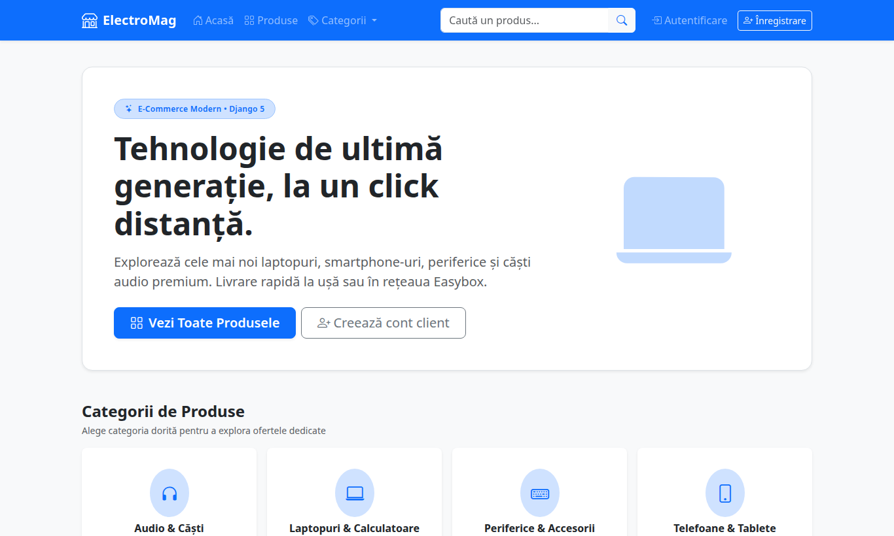
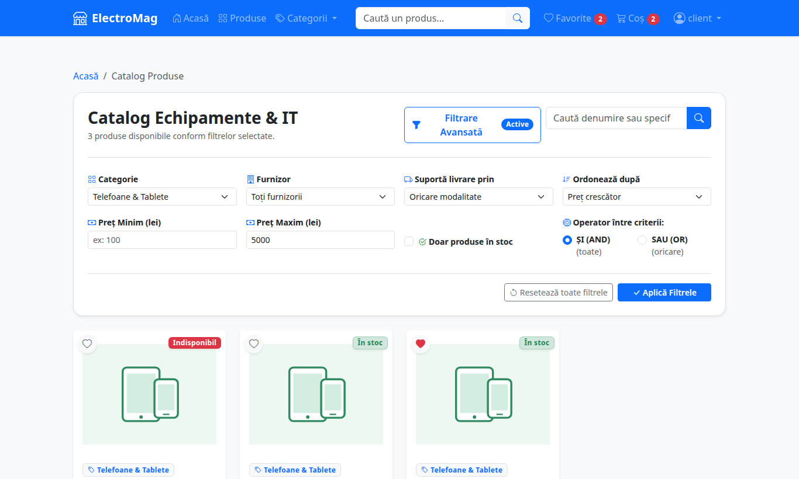
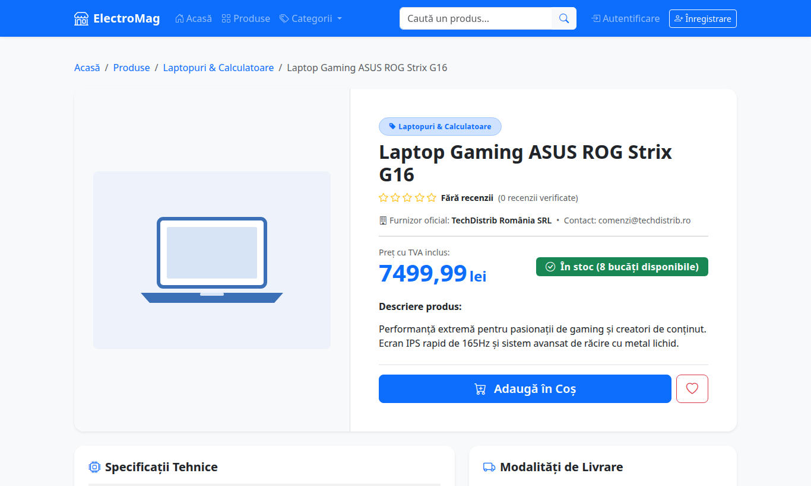
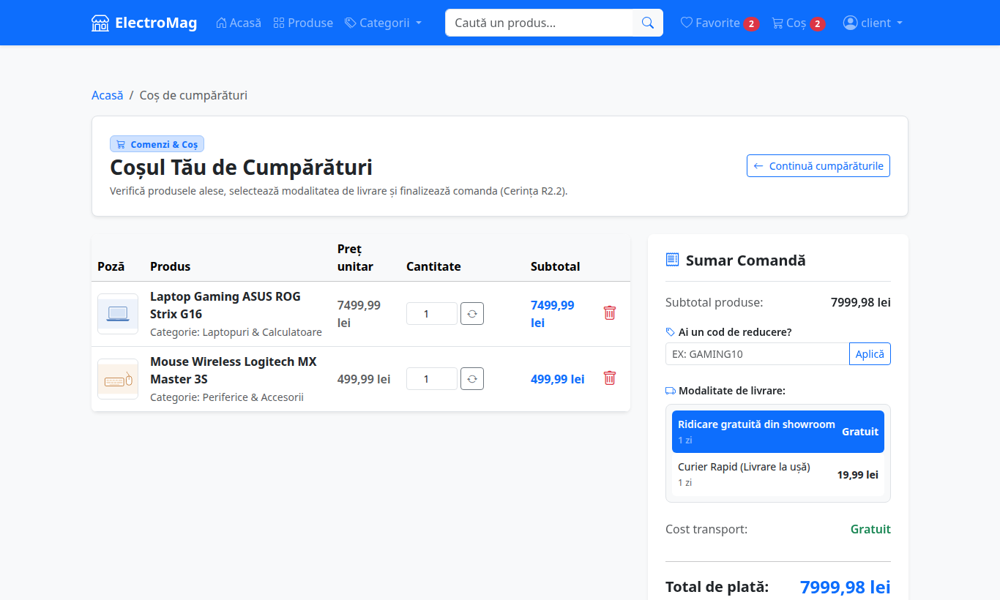
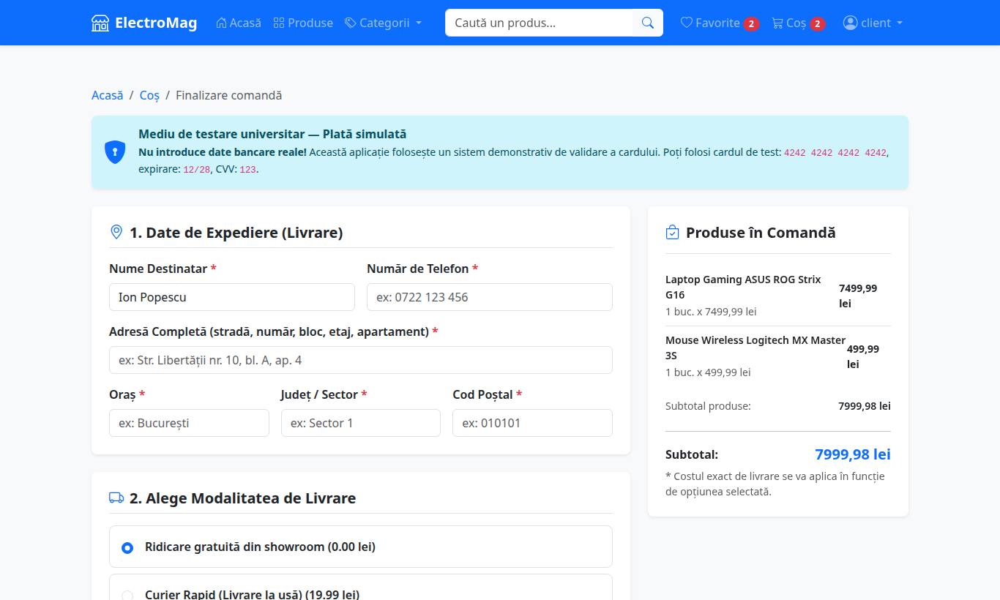
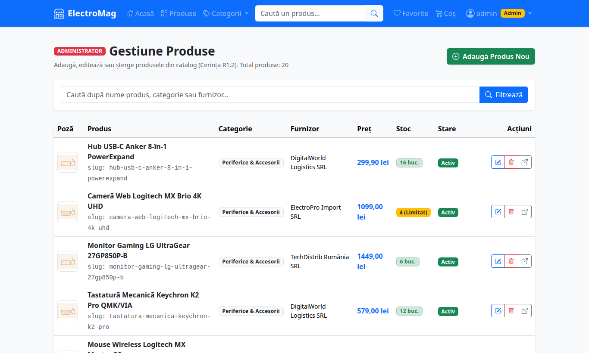
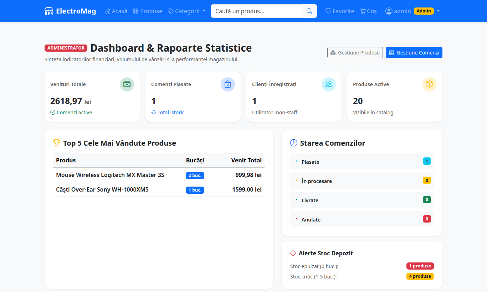

<div align="center">

# 🛒 ElectroMag: Magazin Online

**Aplicație web de comerț electronic (MVC), cu rol de administrator și rol de client**

Proiect pentru disciplina *Comerț Electronic*, Tema II: aplicație web personalizată

[](https://www.python.org/)
[](https://www.djangoproject.com/)
[](https://getbootstrap.com/)
[](https://www.sqlite.org/)
[](#-teste-automate)

[Instalare rapidă](#-instalare-și-rulare) · [Funcționalități](#-funcționalități) · [Conturi demo](#-conturi-și-date-de-test) · [Documentație](#-documentație)



</div>

---

## 📋 Despre proiect

ElectroMag este un magazin online de electronice construit cu **Django 5** după arhitectura **MVC**. Administratorul gestionează produsele și comenzile. Clientul răsfoiește catalogul, își salvează produsele preferate, le adaugă în coș și plasează comenzi, pe care le regăsește apoi în istoric.

Aplicația pornește cu **o singură comandă**, care instalează tot ce trebuie și încarcă automat date demo: 20 de produse, 4 categorii, furnizori, metode de livrare și conturi de test.

---

## ⚡ Instalare și rulare

### 1. Cerințe

Ai nevoie doar de **[Python 3.12 sau mai nou](https://www.python.org/downloads/)**.

> [!IMPORTANT]
> **Pe Windows nu instalezi nimic de mână:** dacă Python lipsește, `pornire.bat` îl instalează singur (are nevoie de internet). Doar dacă instalarea automată nu e posibilă, se deschide python.org: acolo bifează căsuța **„Add python.exe to PATH”** la instalare.

### 2. Descarcă proiectul

**Varianta A, fără Git:** apasă butonul verde **Code → Download ZIP** de pe această pagină, apoi dezarhivează folderul.

**Varianta B, cu Git:**
```bash
git clone https://github.com/vaduvalex17/Comert-Electronic-Proiect.git
cd Comert-Electronic-Proiect
```

### 3. Pornește aplicația

| Sistem | Ce faci |
|---|---|
| 🪟 **Windows** | Dublu click pe **`pornire.bat`** |
| 🐧 **Linux / 🍎 macOS** | În terminal, în folderul proiectului: `chmod +x pornire.sh && ./pornire.sh` |

Scriptul face automat cei 4 pași (prima pornire durează 1-2 minute):

1. creează mediul virtual Python (`venv/`) — pe Windows, instalează înainte Python dacă lipsește;
2. instalează dependențele din `requirements.txt`;
3. creează baza de date și încarcă datele demo;
4. pornește serverul pe un port liber și, pe Windows, deschide singur browserul.

### 4. Deschide magazinul

Pe Windows, magazinul se deschide singur în browser. Altfel, când în fereastră apare mesajul de pornire, intră în browser la:

<div align="center">

### 👉 **http://127.0.0.1:8000**

</div>

> [!TIP]
> Lasă fereastra scriptului deschisă cât timp folosești site-ul. Ca să oprești serverul, apasă **CTRL + C** în ea.

<details>
<summary><b>Rulare manuală, fără script (pentru utilizatori avansați)</b></summary>

```bash
python -m venv venv
source venv/bin/activate          # Windows: venv\Scripts\activate
pip install -r requirements.txt
python manage.py migrate
python manage.py populeaza_date
python manage.py runserver
```
</details>

---

## 🔑 Conturi și date de test

| Rol | Utilizator | Parolă | Acces |
|---|---|---|---|
| 👑 Administrator | `admin` | `admin123` | Produse (CRUD), comenzi, dashboard cu statistici |
| 👤 Client | `client` | `client123` | Catalog, favorite, coș, comenzi, recenzii |

Clienți noi se pot înregistra direct din pagina **Înregistrare**.

**Plata este simulată.** Poți folosi aceste date:

| Câmp | Valoare |
|---|---|
| Card valid | `4242 4242 4242 4242` |
| Expirare / CVV | `12/28` / `123` |
| Card invalid (respins de verificarea Luhn) | `4532 0000 0000 0001` |

**Coduri de reducere demo:**

| Cod | Reducere | Condiție |
|---|---|---|
| `GAMING10` | 10% | fără prag minim |
| `STUDENT15` | 15% | comandă de minimum 200 lei |
| `ELECTRO20` | 20% | comandă de minimum 1000 lei |

---

## ✨ Funcționalități

### Cerințele temei

| | Funcționalitate | Detalii |
|---|---|---|
| ✅ | **Autentificare cu 2 roluri** | Admin și client, înregistrare publică doar pentru clienți |
| ✅ | **Administrare produse (CRUD)** | Adăugare, editare, ștergere. Ștergerea e „soft” dacă produsul a fost deja comandat |
| ✅ | **Produs complet** | Nume, descriere, specificații, preț, stoc, furnizor, modalități de livrare, categorie, imagine |
| ✅ | **Răsfoire catalog** | Categorii, căutare după nume și descriere, paginare |
| ✅ | **Listă de favorite** | Adăugare sau eliminare dintr-un click, mutare directă în coș |
| ✅ | **Coș și finalizare comandă** | Adresă de livrare, date card, alegerea modalității de livrare, cost de livrare inclus în total |
| ✅ | **Istoric comenzi** | Lista comenzilor și detaliul fiecăreia. Adminul gestionează statusul comenzilor |

### Funcționalități suplimentare

- 🔎 **Filtrare avansată cu operatori ȘI / SAU**: după categorie, furnizor, preț, stoc și livrare, plus sortare după preț
- 🏷️ **Coduri de reducere**, cu procent, prag minim și dată de expirare
- ⭐ **Recenzii și rating**, doar de la cumpărători verificați
- 📊 **Dashboard pentru administrator**: venituri, top produse vândute, alerte de stoc
- 🚚 **Livrare inteligentă**: în coș apar doar metodele de livrare acceptate de toate produsele
- ℹ️ **Pagini Despre noi și Contact**

### Securitate

- Parole stocate ca hash (PBKDF2) și protecție **CSRF** pe toate formularele
- Paginile de administrare sunt protejate de un decorator dedicat (`@doar_admin`)
- **Numărul complet al cardului și CVV-ul nu se salvează niciodată**, doar ultimele 4 cifre
- Fiecare client își vede doar propriile comenzi (protecție IDOR, răspuns 404)
- Comanda se plasează într-o **tranzacție atomică**, cu blocarea stocului, deci un produs nu se poate vinde peste stoc

---

## 🖼️ Capturi de ecran

<table>
  <tr>
    <td align="center"><br><sub>Catalog cu filtrare ȘI / SAU</sub></td>
    <td align="center"><br><sub>Detaliu produs</sub></td>
  </tr>
  <tr>
    <td align="center"><br><sub>Coș de cumpărături</sub></td>
    <td align="center"><br><sub>Finalizare comandă</sub></td>
  </tr>
  <tr>
    <td align="center"><br><sub>Administrare produse</sub></td>
    <td align="center"><br><sub>Dashboard administrator</sub></td>
  </tr>
</table>

---

## 🏗️ Arhitectură și structură

Aplicația urmează modelul **MVC**, numit în Django **MTV**:

| MVC | În Django | Unde se află |
|---|---|---|
| **Model** (datele) | Model | `*/models.py` |
| **View** (interfața) | Template | `templates/` și `*/templates/` |
| **Controller** (logica) | View + URL | `*/views.py`, `*/urls.py` |

```
Comert-Electronic-Proiect/
├── magazin/          # Setările proiectului și rutele principale
├── conturi/          # Autentificare, înregistrare, roluri
├── catalog/          # Produse, categorii, furnizori, recenzii, administrare
├── cumparaturi/      # Favorite, coș, coduri de reducere, comenzi
├── templates/        # Șablonul comun al paginilor
├── static/           # CSS și imagini
├── docs/             # Documentație detaliată
├── prezentare/       # Slide-urile pentru raportări
├── pornire.bat       # Pornire automată pe Windows
├── pornire.sh        # Pornire automată pe Linux / macOS
└── requirements.txt  # Dependențe: Django și Pillow
```

---

## 🧪 Teste automate

Proiectul are **73 de teste automate**. Ele acoperă roluri și permisiuni, CRUD, coșul, validarea cardului (Luhn), tranzacția de plasare a comenzii, protecția IDOR și filtrarea ȘI / SAU.

```bash
venv/bin/python manage.py test          # Linux / macOS
venv\Scripts\python manage.py test      # Windows
```

---

## 🛠️ Probleme frecvente

| Problemă | Soluție |
|---|---|
| „Python s-a instalat. Inchide aceasta fereastra...” | Închide fereastra și dă din nou dublu click pe `pornire.bat` |
| Se deschide pagina python.org | Instalează Python cu **„Add python.exe to PATH”** bifat, apoi pornește din nou scriptul |
| „Windows protected your PC” | Apasă **More info → Run anyway** |
| „Portul 8000 este ocupat” | Scriptul alege singur portul următor; închide fereastra veche ca să nu ai două servere pornite |
| Pagina nu se încarcă | Verifică dacă fereastra scriptului e încă deschisă |
| Vreau datele demo de la zero | Oprește serverul, șterge `db.sqlite3` și pornește din nou scriptul |

---

## 📚 Documentație

Documentația detaliată, în limba română, se află în folderul [`docs/`](docs/):

| Document | Conținut |
|---|---|
| [00-START-AICI](docs/00-START-AICI.md) | Ghid pas cu pas de pornire și depanare |
| [01-ce-face-aplicatia](docs/01-ce-face-aplicatia.md) | Funcționalitățile și legătura lor cu cerințele |
| [02-arhitectura](docs/02-arhitectura.md) | Arhitectura MVC și rolul fiecărui fișier |
| [03-baza-de-date](docs/03-baza-de-date.md) | Structura bazei de date și diagrama ER |
| [04-fluxuri](docs/04-fluxuri.md) | Fluxurile principale: cumpărare, administrare |
| [05-harta-codului](docs/05-harta-codului.md) | Unde găsești fiecare funcționalitate în cod |
| [06-glosar](docs/06-glosar.md) | Termenii tehnici explicați simplu |
| [DECIZII](docs/DECIZII.md) | Deciziile tehnice luate pe parcurs |

Slide-urile pentru raportări se află în [`prezentare/`](prezentare/). Textul de prezentare e în notele fiecărui slide.

---

<div align="center">
<sub>Proiect realizat pentru disciplina Comerț Electronic · Django 5 · Python · Bootstrap 5</sub>
</div>
