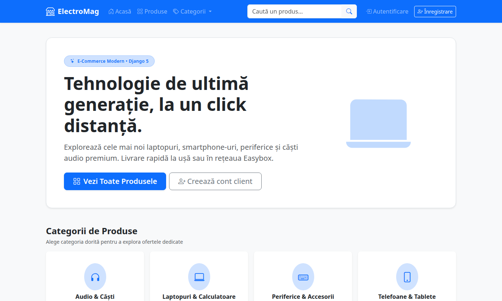
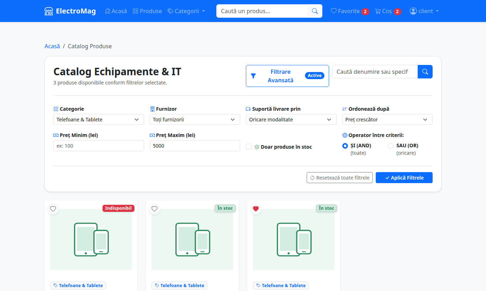
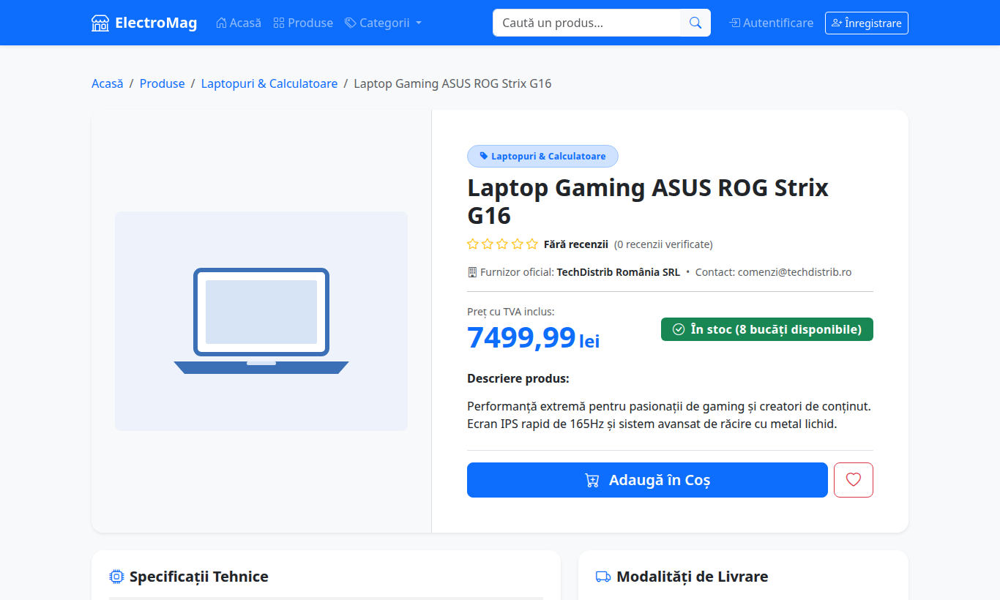
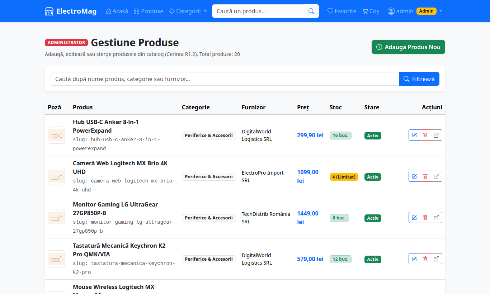
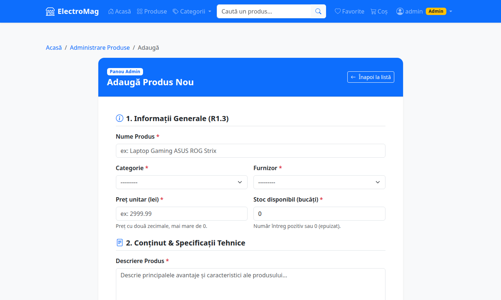
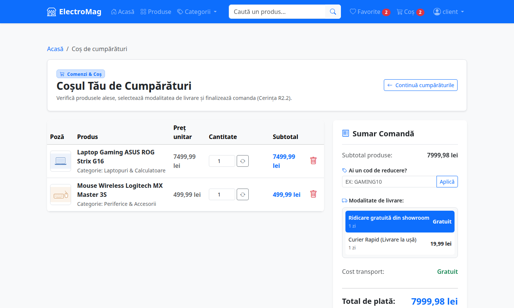
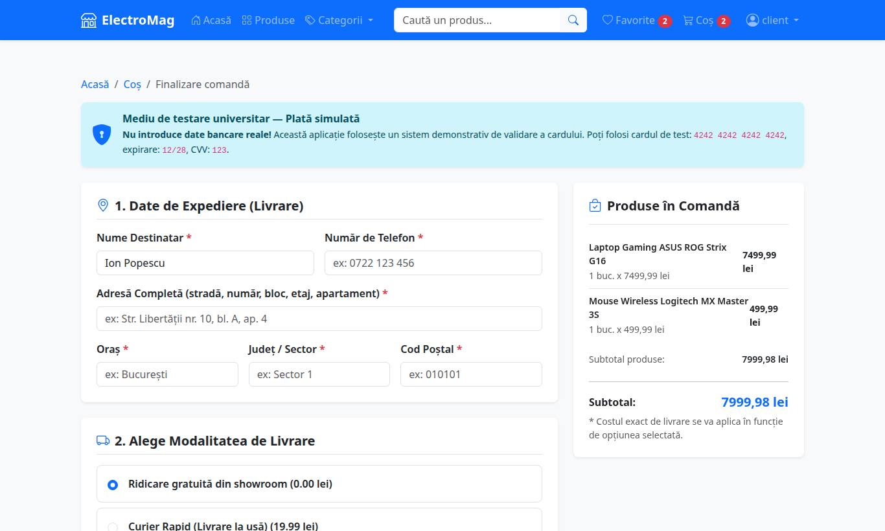
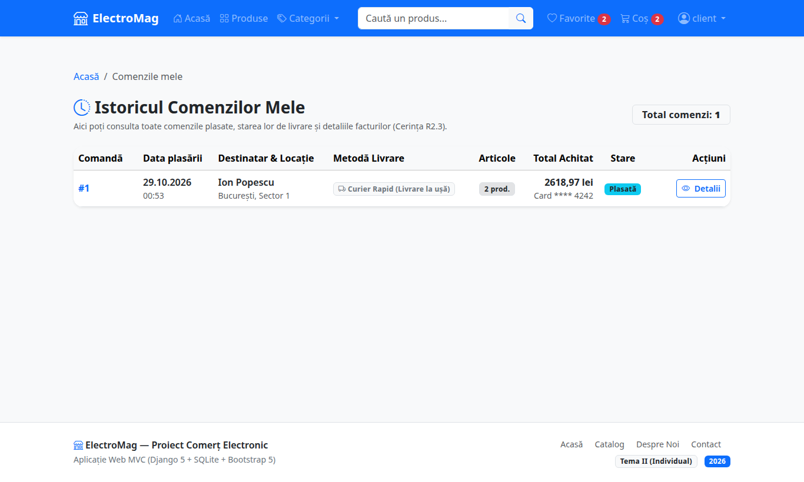
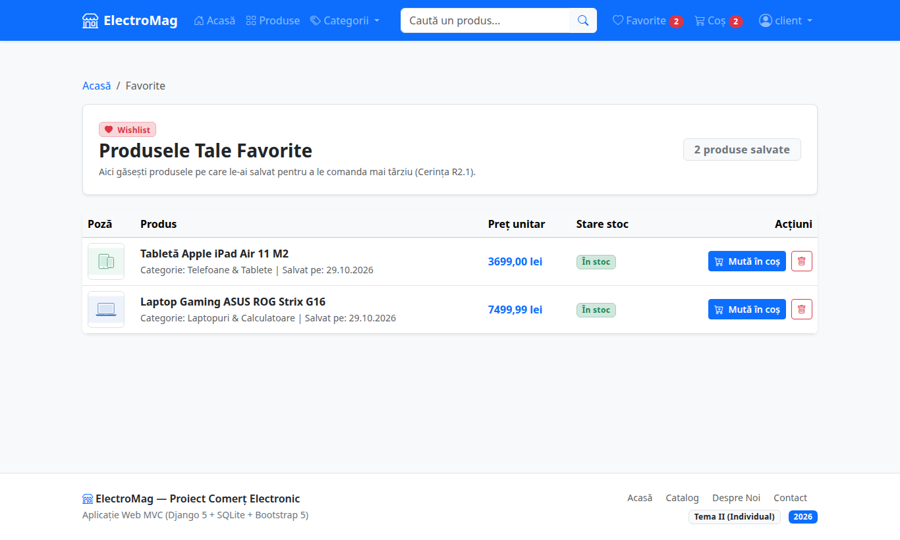
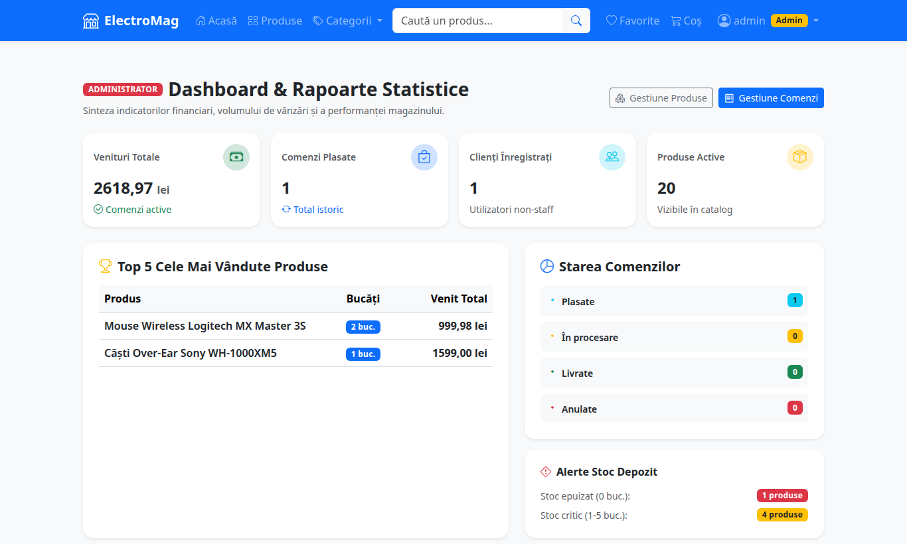

# 01. Ce face aplicația

Aplicația este un magazin electronic complet care permite vânzarea de produse online, acoperind toate fluxurile standard de e-commerce.

---

## 1. Rolurile utilizatorilor

În magazin există două roluri distincte:
1. **Vizitator / Client:**
   - Poate explora catalogul de produse și categoriile.
   - Poate căuta produse după nume sau descriere.
   - Își poate crea un cont propriu și se poate autentifica.
   - Poate adăuga produse în lista de favorite (Wishlist).
   - Poate adăuga produse în coșul de cumpărături și poate modifica cantitățile.
   - Poate finaliza o comandă (introducând datele de livrare și datele simulate de card).
   - Poate consulta istoricul propriilor comenzi plasate.

2. **Administrator (Admin / Staff):**
   - Are acces la panoul de administrare a catalogului.
   - Poate adăuga produse noi cu toate specificațiile cerute.
   - Poate edita datele produselor existente (preț, stoc, imagine etc.).
   - Poate șterge produse (cu protecție: dacă un produs a fost deja comandat în trecut, acesta devine inactiv pentru a nu distruge istoricul comenzilor).
   - Are acces și la panoul nativ Django (`/admin/`).

---

## 2. Corelarea cu cerințele oficiale de notare

### Raportarea I (Săptămâna 7/8 — 40% din nota de proiect)
- **R1.1 Autentificare:** Login și înregistrare diferențiate (client vs. admin).
- **R1.2 Gestiune produse:** Adăugare, editare și ștergere de produse din interfață.
- **R1.3 Câmpurile unui produs:** Nume, descriere, specificații detaliate, preț, stoc, furnizor, modalități de livrare, categorie.
- **R1.4 Răsfoire catalog:** Navigare pe categorii, căutare produse, paginare.

### Raportarea II (Săptămâna 11/12 — 60% din nota de proiect)
- **R2.1 Wishlist / Favorite:** Salvarea produselor preferate și posibilitatea mutării lor în coș.
- **R2.2 Flow de cumpărare:** Coș interactiv, alegere modalitate livrare, calcul automat total, formular de livrare și date card (simulat).
- **R2.3 Istoric comenzi:** Vizualizarea comenzilor anterioare cu detalii complete și status.

---

## 3. Funcționalități în plus (bonusuri pentru „realizare deosebită”)

Pe lângă cerințele obligatorii, aplicația mai are:

| Bonus | Ce face | Cine îl folosește |
|---|---|---|
| **Filtrare avansată ȘI / SAU** | Pe pagina *Produse* se pot combina filtre (categorie, furnizor, preț minim/maxim, doar în stoc, metodă de livrare). Cu **ȘI** produsul trebuie să respecte toate filtrele; cu **SAU** e suficient unul. Se poate și sorta după preț, nume sau noutate. | Oricine |
| **Coduri de reducere** | În coș se poate introduce un cupon: `GAMING10` (10%), `STUDENT15` (15%, minimum 200 lei), `ELECTRO20` (20%, minimum 1000 lei). Reducerea apare în sumar și se salvează în comandă. | Client |
| **Recenzii verificate** | Doar cine a cumpărat produsul poate da o notă (1–5 stele) și un comentariu. Media notelor apare pe card și pe pagina produsului. | Client |
| **Dashboard statistici** | Venituri, număr de comenzi și clienți, top 5 produse vândute, alerte de stoc. | Admin |
| **Administrare comenzi** | Adminul vede comenzile tuturor clienților și le schimbă statusul (Plasată → În procesare → Livrată / Anulată). | Admin |
| **Pagini Despre și Contact** | Pagini de prezentare a magazinului. | Oricine |
| **Factură printabilă** | Detaliul unei comenzi are buton de printare / salvare ca PDF. | Client |

---

## 4. Cum arată aplicația

| | |
|---|---|
|  |  |
| **Acasă**: categorii și produse noi | **Catalog**: căutare, filtre ȘI/SAU, paginare |
|  |  |
| **Detaliu produs**: toate câmpurile R1.3 | **Admin**: tabel produse cu Editează / Șterge |
|  |  |
| **Admin**: formular adăugare produs | **Coș**: sumar, livrări comune, cupon |
|  |  |
| **Finalizare**: adresă, livrare, card simulat | **Istoric comenzi** |
|  |  |
| **Favorite (wishlist)** | **Dashboard admin** |
