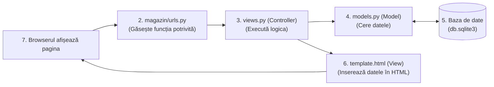

# 02. Arhitectura Aplicației

Proiectul implementează modelul arhitectural clasic **MVC** (Model-View-Controller), care în ecosistemul Django poartă denumirea de **MTV** (Model-Template-View).

---

## 1. Corespondența MVC în Django

| Concept MVC | Echivalent în Django | Unde se găsește în cod | Ce face |
|---|---|---|---|
| **Model** (Datele) | `models.py` | `catalog/models.py`, `cumparaturi/models.py` | Definește tabelele, câmpurile și relațiile din baza de date. |
| **View** (Interfața) | **Template** (`.html`) | `templates/` și `*/templates/*/*.html` | Codul HTML stilizat cu Bootstrap pe care îl vede utilizatorul în browser. |
| **Controller** (Logica) | **View** (`views.py`) + `urls.py` | `catalog/views.py`, `cumparaturi/views.py` | Primește cererea de la browser, interoghează baza de date și alege template-ul de afișat. |

---

## 2. Drumul unei cereri (Request Flow)

---

## 3. Cele trei aplicații Django ale magazinului

1. **`conturi`**: Se ocupă exclusiv de identitatea utilizatorilor (autentificare, deconectare, creare cont client, verificarea rolului de administrator).
2. **`catalog`**: Gestionează entitățile comerciale expuse: categorii, produse, furnizori, modalități de livrare și panoul de administrare pentru produse.
3. **`cumparaturi`**: Gestionează interacțiunea dinamică a clientului cu magazinul: salvarea favoritelor, starea coșului, validarea finalizării comenzii și salvarea istoricului tranzacțiilor.
