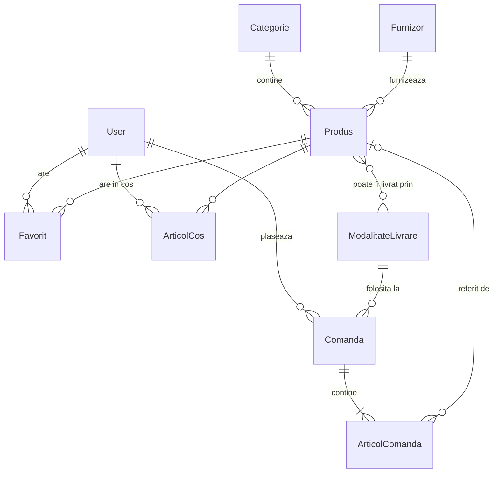

# 03. Structura Bazei de Date

Baza de date a aplicației este stocată local într-un singur fișier compact `db.sqlite3`.
Toate operațiunile de creare, citire, actualizare și ștergere se realizează prin **Django ORM** (fără comenzi SQL scrise manual), ceea ce oferă protecție nativă împotriva atacurilor de tip SQL Injection.

---

## 1. Diagrama Entitate-Relație (ER)

---

## 2. Tabelele aplicației `catalog`

### 2.1 Modelul `Categorie`
Grupează produsele similare în catalogul magazinului.
- `nume` (`CharField`, max 100, unic): Numele categoriei (ex: *Laptopuri & Calculatoare*).
- `slug` (`SlugField`, max 120, unic): Identificator lizibil pentru URL (generat automat din nume, ex: `laptopuri`).
- `descriere` (`TextField`, opțional): Scurtă descriere a categoriei.

### 2.2 Modelul `Furnizor`
Reprezintă distribuitorul sau compania parteneră.
- `nume` (`CharField`, max 150, unic): Numele companiei (ex: *TechDistrib România SRL*).
- `email` (`EmailField`): Adresa de email de contact.
- `telefon` (`CharField`, max 20): Numărul de telefon de suport.

### 2.3 Modelul `ModalitateLivrare`
Opțiunile de livrare pe care clientul le poate alege la comandă.
- `nume` (`CharField`, max 100, unic): Metoda de expediere (ex: *Curier Rapid*, *Easybox*).
- `cost` (`DecimalField`, max 6 cifre, 2 zecimale, $\ge 0$): Tariful de transport în lei.
- `zile_estimate` (`PositiveIntegerField`): Timpul estimat de livrare în zile lucrătoare.

### 2.4 Modelul `Produs` (Cerința R1.3)
Entitatea centrală a magazinului online.
- `nume` (`CharField`, max 200): Numele produsului.
- `slug` (`SlugField`, max 220, unic): Identificator web unic (ex: `laptop-gaming-asus-rog-strix-g16`).
- `descriere` (`TextField`): Textul promoțional și descrierea produsului.
- `specificatii` (`TextField`): Text structurat pe rânduri în formatul `Cheie: Valoare`. Metoda `specificatii_lista()` îl transformă automat într-un tabel HTML în pagina de produs.
- `pret` (`DecimalField`, max 10 cifre, 2 zecimale, $\ge 0.01$): Prețul de vânzare în lei. Folosim strict `Decimal`, niciodată `float`, pentru a preveni erorile de rotunjire financiară.
- `stoc` (`IntegerField`, $\ge 0$): Numărul de bucăți disponibile.
- `imagine` (`ImageField`, opțional): Fotografia produsului, încărcată în `media/produse/`.
- `categorie` (`ForeignKey` la `Categorie`, `on_delete=PROTECT`): Categoria din care face parte.
- `furnizor` (`ForeignKey` la `Furnizor`, `on_delete=PROTECT`): Distribuitorul asociat.
- `modalitati_livrare` (`ManyToManyField` la `ModalitateLivrare`): Opțiunile de expediere compatibile.
- `activ` (`BooleanField`, implicit `True`): Dacă produsul este vizibil în magazin.
- `creat_la`, `actualizat_la` (`DateTimeField`): Marcaje temporale automate.

**Metode și proprietăți utile pe `Produs`:**
- `specificatii_lista()`: Transformă textul pe linii în perechi `[('Procesor', 'Intel i7'), ...]`.
- `in_stoc`: Returnează `True` dacă `stoc > 0`.
- `stare_stoc`: Returnează `"În stoc"`, `"Stoc limitat"` (dacă $\le 5$ bucăți) sau `"Indisponibil"` (dacă $0$).

---

## 3. Tabelele aplicației `cumparaturi`

### 3.1 Modelul `Favorit` (Cerința R2.1 - Wishlist)
- `utilizator` (`ForeignKey` la `User`): Clientul care a marcat produsul.
- `produs` (`ForeignKey` la `Produs`): Produsul salvat.
- `adaugat_la` (`DateTimeField`): Data salvării în listă.
- Relație unică `(utilizator, produs)`: Nu permite adăugarea dublurilor.

### 3.2 Modelul `ArticolCos` (Cerința R2.2)
- `utilizator` (`ForeignKey` la `User`): Proprietarul coșului.
- `produs` (`ForeignKey` la `Produs`): Produsul adăugat.
- `cantitate` (`PositiveIntegerField`, $\ge 1$): Numărul de unități dorite.
- `adaugat_la` (`DateTimeField`): Data adăugării.
- `subtotal`: Proprietate calculată (`produs.pret * cantitate`).

### 3.3 Modelul `Comanda` (Cerințele R2.2 și R2.3)
- `utilizator` (`ForeignKey` la `User`): Clientul care a finalizat achiziția.
- `creata_la` (`DateTimeField`): Data și ora plasării comenzii.
- `status`: Starea comenzii (`plasata`, `in_procesare`, `livrata`, `anulata`).
- Date de expediere: `nume_destinatar`, `telefon`, `adresa`, `oras`, `judet`, `cod_postal`.
- Financiar: `modalitate_livrare` (`ForeignKey`), `cost_livrare`, `subtotal`, `total`.
- Plată: `card_ultimele4` (stochează doar ultimele 4 cifre ale cardului; codul CVV și numărul complet **nu se salvează niciodată**).

### 3.4 Modelul `ArticolComanda` (Snapshot comandă)
- `comanda` (`ForeignKey` la `Comanda`, `CASCADE`).
- `produs` (`ForeignKey` la `Produs`, `SET_NULL`, nullable).
- `nume_produs` (`CharField`): Copie exactă a numelui din momentul achiziției.
- `pret_unitar` (`DecimalField`): Prețul exact din momentul plasării comenzii.
- `cantitate` (`PositiveIntegerField`).
- `subtotal`: `pret_unitar * cantitate`.

---

## 4. Reguli esențiale de integritate și securitate

1. **Prețuri istorice nemodificabile (Snapshot):** În `ArticolComanda`, prețul este copiat explicit. Dacă un administrator scumpește sau ieftinește ulterior un produs în catalog, istoricul comenzilor deja finalizate nu suferă nicio modificare.
2. **Ștergere protejată (Soft-delete):** Dacă un produs a fost deja inclus într-o comandă, el **nu este șters fizic** din baza de date, ci doar marcat `activ=False`. În caz contrar, comanda ar rămâne fără produsul achiziționat.
3. **Plată sigură:** Cardul bancar este simulat. Nu procesăm plăți reale și nu stocăm numărul complet de 16 cifre sau codul CVV, ci doar ultimele 4 cifre pentru referință pe factură.

---

## 5. Date demonstrative inițiale (`populeaza_date`)

Rularea comenzii `python manage.py populeaza_date` generează automat un set complet de date:
- **Conturi demo:**
  - `admin` (parolă `admin123`) — rol Staff / Superuser.
  - `client` (parolă `client123`) — rol Cumpărător.
- **Categorii (4):** Laptopuri & Calculatoare, Telefoane & Tablete, Audio & Căști, Periferice & Accesorii.
- **Furnizori (3):** TechDistrib România SRL, ElectroPro Import SRL, DigitalWorld Logistics SRL.
- **Modalități livrare (3):** Curier Rapid (19.99 lei), Easybox (11.99 lei), Ridicare din showroom (0.00 lei).
- **Produse (20):** Produse electronice de top, cu specificații reale, prețuri corecte și stocuri diferențiate (inclusiv stoc limitat și stoc 0).
