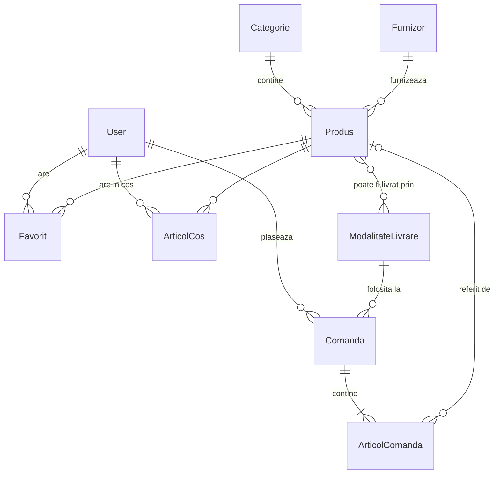

# 03. Structura Bazei de Date

Baza de date este stocată local într-un singur fișier compact `db.sqlite3`.
Toate operațiunile de creare, citire, actualizare și ștergere se realizează prin **Django ORM** (fără comenzi SQL scrise manual), ceea ce oferă protecție nativă împotriva atacurilor de tip SQL Injection.

---

## 1. Diagrama Entitate-Relație (ER)

---

## 2. Tabelele aplicației `catalog`

- **`Categorie`**: Grupează produsele similare (ex. *Laptopuri*, *Telefoane*, *Accesorii*). Are un identificator lizibil pentru URL (`slug`).
- **`Furnizor`**: Compania parteneră care livrează stocul (nume, email, telefon).
- **`ModalitateLivrare`**: Opțiunile de expediere disponibile (ex: *Curier rapid*, *Easybox*, *Ridicare personală*), fiecare cu un cost fix și un timp estimat.
- **`Produs`**: Elementul central al magazinului:
  - Câmpuri: nume, descriere, specificații tehnice (text structurat cheie: valoare), preț (`Decimal`), stoc (întreg), imagine, categorie, furnizor, modalități de livrare asociate și starea de activare (`activ=True/False`).

---

## 3. Tabelele aplicației `cumparaturi`

- **`Favorit`**: Relație unică între un utilizator și un produs marcat cu „inimă”.
- **`ArticolCos`**: Produsele selectate de utilizator și cantitatea dorită. Salvarea în baza de date permite păstrarea coșului între sesiuni de logare.
- **`Comanda`**: Comanda plasată de client (date de expediere, adresă, modalitate de livrare aleasă, cost de livrare, total, status, ultimele 4 cifre ale cardului).
- **`ArticolComanda`**: Snapshot (copie fixă) a produselor din comandă: salvează numele produsului și prețul exact din momentul achiziției, astfel încât modificările ulterioare de preț din catalog să nu afecteze facturile vechi.

---

## 4. Reguli importante de integritate

1. **Prețuri nemodificabile retroactiv:** În `ArticolComanda`, prețul este salvat ca valoare de sine stătătoare, nu doar ca referință la produs.
2. **Ștergere protejată (Soft-delete):** Un produs care apare deja în comenzi finalizate nu va fi șters fizic din baza de date, ci doar marcat ca `activ=False`. În caz contrar, istoricul comenzilor ar rămâne fără produsul achiziționat.
3. **Confidențialitate date bancare:** În baza de date se salvează **doar ultimele 4 cifre** ale cardului (ex: `**** 4242`). Codul CVV și numărul complet nu sunt niciodată înregistrate.
