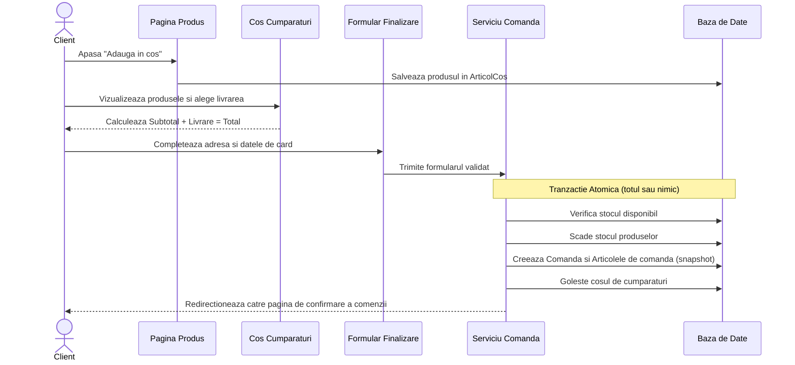

# 04. Fluxurile Aplicației

Acest document descrie modul în care circulă datele în timpul celor mai importante acțiuni ale utilizatorului.

---

## 1. Fluxul de Cumpărare (Checkout)

---

## 2. Fluxul de Administrare a Produselor (Admin)

1. Administratorul se autentifică cu contul de staff.
2. Accesează panoul `/administrare/produse/`.
3. Completează formularul de adăugare/editare produs (inclusiv imagine și modalități de livrare).
4. La salvare, Django validează câmpurile (preț pozitiv, stoc nenegativ, slug unic).
5. La ștergere:
   - Dacă produsul **nu** a fost comandat niciodată: este șters fizic din baza de date.
   - Dacă produsul **a fost** inclus în comenzi: este dezactivat (`activ=False`), ascuns din catalogul public, dar păstrat pentru evidența comenzilor anterioare.
