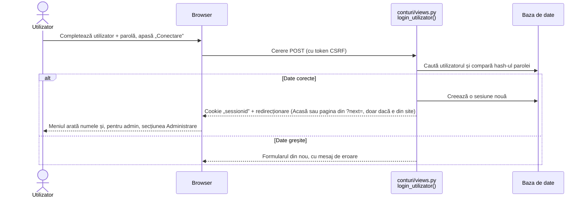
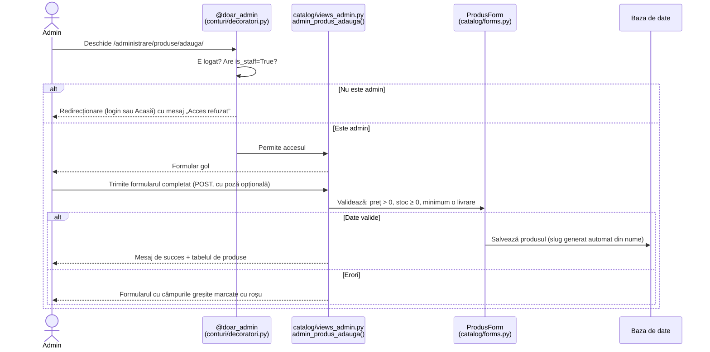
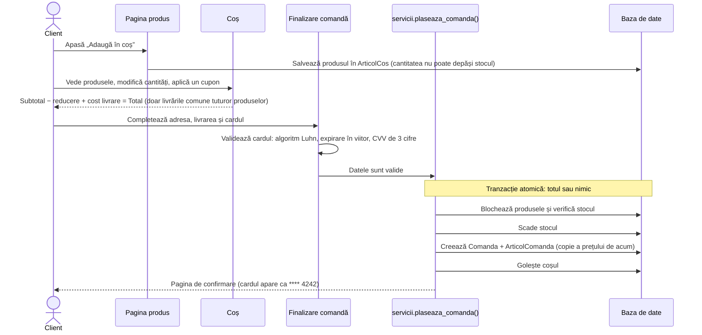
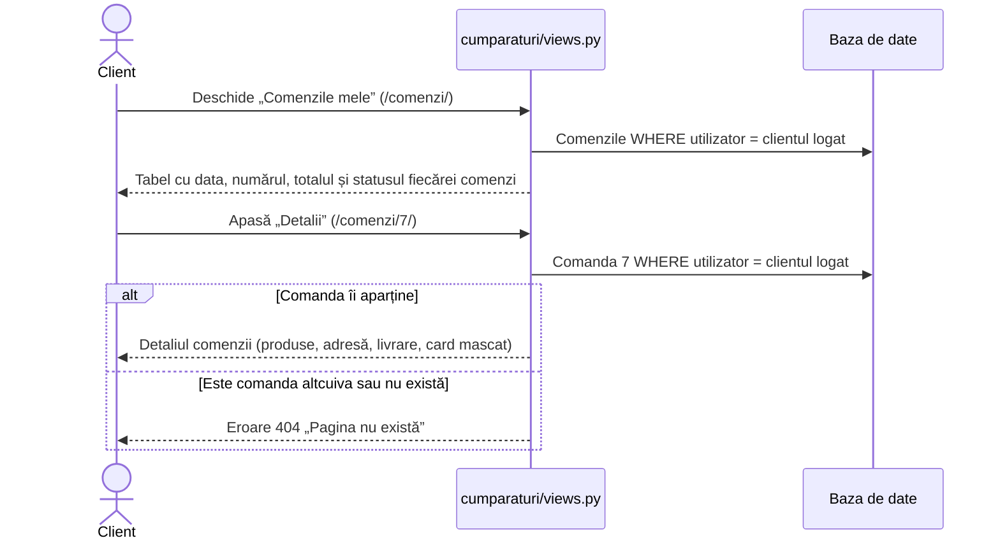

# 04. Fluxurile Aplicației

Acest document arată, pas cu pas, ce se întâmplă „în spatele ecranului” la cele mai importante acțiuni.
Diagramele se citesc de sus în jos: fiecare săgeată este un mesaj de la cineva către altcineva.

---

## 1. Autentificarea (Login) — R1.1

**De reținut:** parola nu este salvată niciodată „în clar”, ci doar sub formă de *hash* (o amprentă din care parola nu poate fi refăcută).
La login, Django calculează hash-ul parolei introduse și îl compară cu cel salvat.

---

## 2. Adăugarea unui produs de către admin — R1.2

**Ștergerea** urmează aceeași cale, cu o regulă în plus:
- dacă produsul **nu** a fost comandat niciodată, este șters fizic din baza de date;
- dacă produsul **a fost** comandat, este doar dezactivat (`activ=False`, *soft-delete*): dispare din catalog, dar comenzile vechi rămân complete.

---

## 3. Fluxul de cumpărare (Checkout) — R2.2

Dacă între timp stocul nu mai ajunge (de exemplu, alt client a cumpărat ultima bucată), tranzacția este anulată:
nu se salvează nicio comandă, stocul rămâne neatins, iar clientul primește un mesaj care numește produsul.

---

## 4. Istoricul comenzilor — R2.3

**De ce 404 și nu „Acces interzis”?** Un mesaj de tip „nu ai voie” ar confirma că acea comandă există.
Cu 404, un client curios nu află nimic despre comenzile altora.
